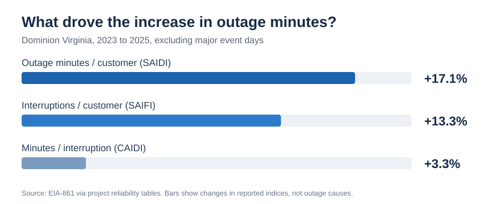
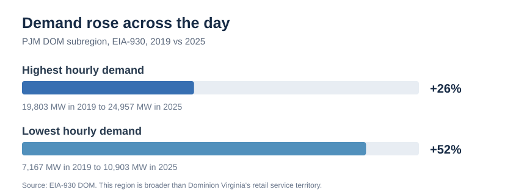

# Dominion Energy Virginia | Reliability review

**A public-data look at customer outages, severe weather and changing electricity demand.**

## Why I did this

Dominion reported that its rolling three-year average SAIDI (outage minutes per customer) rose from about **130 minutes** (2022–2024) to **133 minutes** (2023–2025), excluding major event days. These are overlapping, rolling averages—not two separate three-year periods.

I wanted to look beyond the headline: **Were customers losing power more often, were interruptions lasting longer, and how much context could weather and demand data provide?**

## What I found

### 1. Interruption frequency is the more useful place to investigate



*Chart recreated from the reported EIA-861 values*

From 2023 to 2025, Dominion Virginia's reported reliability measures (excluding major event days) changed as follows:

| Measure | 2023 | 2025 | Change |
|---|---:|---:|---:|
| Outage minutes per customer (SAIDI) | 123.3 | 144.4 | +17% |
| Interruptions per customer (SAIFI) | 1.165 | 1.320 | +13% |
| Average minutes per interruption (CAIDI) | 105.9 | 109.4 | +3% |

**My takeaway:** The rise in outage minutes was associated more with **more frequent interruptions** than with much longer interruptions. That doesn't tell us which equipment or circuits caused the change, but it gives us a better question to pursue.

### 2. Weather helps explain the pattern, but the regression is exploratory

I grouped NOAA storm reports into **storm county-days**: one county with at least one relevant storm report on a given date counts once, even if NOAA recorded several individual events. For Dominion's Virginia service area, the count increased from **465 in 2024** to **796 in 2025**.

I compared annual storm exposure with SAIDI and fitted a simple linear regression using **2015–2024** data, holding 2025 back as a test.

- **Historical correlation:** 0.70 (R² about 0.48).
- **Model estimate for 2025:** 145.3 outage minutes per customer.
- **Actual reported 2025 value:** 144.4 minutes.

The close 2025 result is interesting, **not proof that storms caused the increase or that the model will predict other years accurately**. The fit uses only ten annual observations, doesn't control for infrastructure and maintenance, and compares all-year storm exposure with a reliability measure that excludes major event days. I treat the model-based weather adjustment (about 133 minutes for 2025) as an exploratory comparison, not a verified measure of underlying performance.

Separately, EIA reports **306.7 minutes with all events** versus **144.4 excluding major event days** in 2025. The difference reflects EIA's major-event reporting classification; it should not automatically be labelled as minutes caused by NOAA-recorded storms.

### 3. Demand is changing even outside peak hours



*Chart recreated from EIA-930 figures; this is not a screenshot of Power BI.*

EIA-930 records for the broader **PJM DOM subregion** show that between 2019 and 2025:

- The highest hourly demand increased about **26%**.
- The lowest hourly demand increased about **52%**.

This suggests a changing load profile, not merely a higher annual peak. The DOM subregion is **not identical** to Dominion's Virginia retail territory, and these figures don't establish that demand growth caused outages.

## Why it matters

If I were working with internal operational data, I would start by investigating **which feeders and outage causes are contributing to the rise in interruption frequency**. I'd look at repeat failures, customers affected, equipment condition, vegetation and maintenance history. That could help teams evaluate where preventive work might deliver the greatest reduction in customer outage minutes.

The public data helps narrow down the questions. **It cannot identify the right circuit to upgrade or prove which investment will work.**

## How I approached it

I combined annual utility reliability data from **EIA-861** (historical years standardized by **PUDL**, plus the 2025 EIA release), storm records from **NOAA**, and hourly demand from **EIA-930**. I used SQL to make inconsistent formats comparable, check duplicates and missing values, calculate annual measures, and prepare the data for Power BI.

The technical implementation and checks are available below, but the focus of this review is **what the numbers mean and what I'd investigate next**.

## How the analysis is organized

The work has three steps: **bring together the public reports, check and standardize the numbers in SQL, then explain the results in Power BI**. Each source addresses a different question; I did not merge weather, demand and reliability into one giant record.

| Material | Where to look |
| --- | --- |
| Source data and annual results | [data/](data/) |
| Cleaning, calculations and tests | [sql/](sql/) |
| Supporting explanations and audit trail | [docs/](docs/) |
| Power BI measures and workbook | [powerbi/](powerbi/) |

## How to check the work

The core reliability tables can be recreated locally using the committed EIA/PUDL files:

```bash
python -m pip install -r requirements.txt
python -I scripts/run_local_duckdb.py
```

This runner covers the reliability SQL and its six checks (T1-T6). NOAA and EIA-930 are separate pipelines with six further SQL checks. The local runner does **not** reproduce the entire Power BI report or its 2025 weather fit.

The project includes the Power BI measure definitions and supporting workbook, but **not a .pbix dashboard file**. The two charts above are reproductions of selected findings from the reported figures, not exports from Power BI Desktop.

For data attribution, see [NOTICE.md](NOTICE.md) and [source notes](docs/01_sources.md). Detailed field mappings and known source anomalies are kept in [docs/](docs/) for reproducibility.

## Explore the project

- [How to read the dashboard](docs/06_powerbi_report.md)
- [Data sources](docs/01_sources.md)
- [Worked examples from source rows to results](docs/08_transformations.md)
- [Data-quality checks](docs/03_data_quality.md)
- [SQL transformations and analysis](sql/)
- [Power BI measures](powerbi/measures.dax)

To reproduce the **core reliability** calculations without Snowflake, run `python scripts/run_local_duckdb.py`. The NOAA and hourly-demand analyses use the additional input files and SQL documented in `scripts/` and `sql/`. The Power BI report file itself is not included in the repository.
