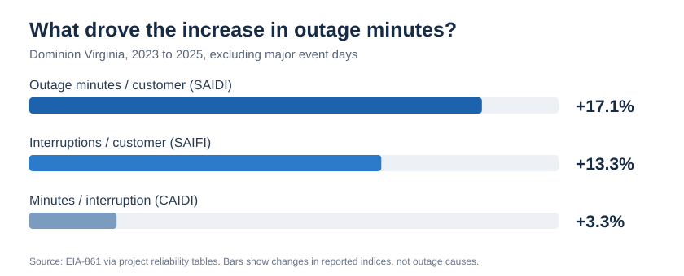
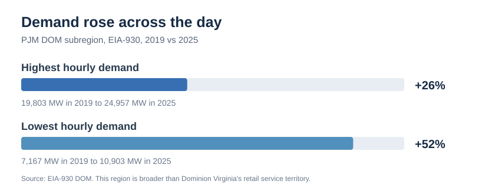

# Dominion Energy Virginia | Reliability Review

**Independent public-data analysis · November 2026**

I built this review to examine changes in electricity reliability across Dominion Energy Virginia's service territory. The analysis combines EIA-861 reliability filings, NOAA storm records and EIA-930 demand data, using SQL for data preparation and Power BI for reporting.

## Key findings

### Interruption frequency warrants closer investigation

Dominion's reported reliability measures, excluding major-event days, changed between 2023 and 2025:

| Measure | 2023 | 2025 | Change |
|---|---:|---:|---:|
| SAIDI — outage minutes per customer | 123.3 | 144.4 | +17% |
| SAIFI — interruptions per customer | 1.165 | 1.320 | +13% |
| CAIDI — minutes per interruption | 105.9 | 109.4 | +3% |



The increase in SAIDI was more closely associated with interruption frequency than with average interruption duration. The annual data identify the performance dimension that changed, but not the affected feeders or physical causes.

### Major-event-day exclusions affect the reported reliability picture

For 2025, EIA-861 reports **306.7 SAIDI minutes including all events** and **144.4 minutes excluding major-event days**. The **162.3-minute difference** reflects the reporting exclusion. It is not a separate measurement of outage minutes caused by NOAA-recorded storms.

### Storm exposure provides context, not causal attribution

The NOAA index used in this review recorded **465 storm county-days in 2024** and **796 in 2025** across Dominion's Virginia service counties. A county-day is counted once when that county has at least one qualifying storm report on the date.

The correlation between annual storm county-days and SAIDI excluding major-event days was **0.70** over the 2015–2024 fitting period. The regression estimated **145.3 minutes** for 2025; the reported result was **144.4 minutes**.

This is an exploratory association based on ten annual observations. The model does not separate weather-related interruptions from equipment, vegetation or maintenance effects, and NOAA's annual storm count does not align exactly with EIA's major-event-day exclusions.

### Electricity demand is changing beyond the annual peak



In the broader PJM DOM subregion, the lowest recorded hourly demand increased approximately **52%** from 2019 to 2025, versus about **26%** for the annual peak. The subregion is not identical to Dominion's Virginia retail service territory, and demand growth alone does not explain changes in outages.

## Presentation and report files

| Deliverable | Location |
|---|---|
| Executive presentation | [Dominion Reliability Review.pptx](C-Suite/Dominion%20Reliability%20Review.pptx) |
| Executive Power BI dashboard | [Dominion_Executive_Dashboards.pbix](C-Suite/Dominion_Executive_Dashboards.pbix) |
| Detailed Power BI charts | [Dominion_Charts_Raw.pbix](powerbi/Dominion_Charts_Raw.pbix) |
| DAX measure reference | [powerbi/measures.dax](powerbi/measures.dax) |

The Power BI files are report snapshots. The separate DAX reference is maintained with the analysis and does not automatically update measures embedded in either PBIX.

## Data and methods

- **[data/](data/)** — published inputs, source references and summary outputs
- **[sql/](sql/)** — raw/staging transformations, reliability mart, analysis queries and quality checks
- **[docs/](docs/)** — source register, data dictionary, calculation definitions, reporting methodology and known limitations
- **[scripts/](scripts/)** — data retrieval, local reproducibility and output checks

The core EIA reliability calculations can be tested locally with:

```bash
python -m pip install -r requirements.txt
python -I scripts/run_local_duckdb.py
```

The local runner checks the core reliability SQL and its six tests. Weather and demand analyses require their additional public-source files and separate processing steps. The repository does not contain Dominion's internal outage-management, circuit or equipment records.

## Operational next step

With utility-level event and circuit data, I would investigate interruption frequency by feeder, cause code, repeat customer interruption and weather conditions. That would support a more targeted review of maintenance and grid-hardening priorities.

This project is an independent analysis of public information, not an official Dominion Energy reliability assessment. Source attribution and data-use notes are in [NOTICE.md](NOTICE.md).
